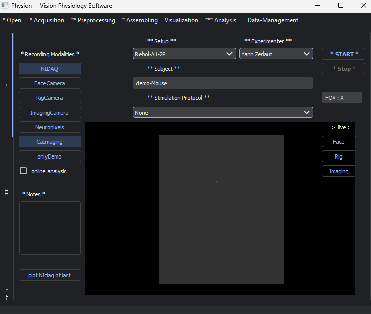

# Multimodal acquisition

Launch the acquisition mode of physion with:
```
python -m physion acquisition
```

## _Prerequisite_

The acquisition setup should have a folder structure like this:

```
~/
   # in the home folder (i.e. the parent folder of the Documents, Downloads, ... folders)
   Documents/...
   Downloads/...

   DATA/
      Joana/
      Yann/
      ...
   visualStim-protocols/
      Joana/
         full-field-gratings-3contrasts/
         ...
      Yann/
         quick-spatial-mapping/
         inverse-receptive-fields/
         ....

```

The sub-folder of each experimenter is set in the `EXPERIMENTERS` dictionary of [__init__.py](./__init__.py) (e.g. `'Yann Zerlaut':{'folder':'Yann'}`). With no experimenter selected, the root folders `~/DATA/` and `~/visualStim-protocols/` are used.

## GUI
The interface is minimal:

<p align="center">
  
</p>

## 1. Pick the configuration ("Setup") that you want to use

The set of configurations is loaded from the files in the [configs/](configs/) folder.

Each file is a JSON file that describes the rig and some key metadata of the experiment, e.g. ([Rebol-Neuropix.json](configs/Rebol-Neuropix.json)):
```
{
    "Rig":"Neuropix-LN-U3screens", "physion-version":2.0,
    "Screen":"LN-VR-3screens",
    "NIdaq":{
        "acquisition-frequency":5000,
        "analog-outputs":{
            "N-channels":0
        },
        "analog-inputs":{
            "N-channels":1,
            "channel-labels":["photodiode-signal-from-screen"]
        },
        "digital-outputs":{
            "lines":"port0/line0:2",
            "line-labels":["ephys-synch-signal-2Hz",
                           "visual-stim-episode-start",
                           "LED-optogenetics-activation"]
        },
        "digital-inputs":{
            "lines":"port0/line3:7",
            "line-labels":["copy-ephys-synch-signal",
                           "locomotion-channel1",
                           "locomotion-channel2",
                           "copy-visual-stim-episode-start",
                           "copy-LED-optogenetics-activation"]
        }
    },
    "FaceCamera":{"frame-rate":30, "1cm-in-pix":480},
    "RigCamera":{"frame-rate":20, "1cm-in-pix":33},
    "ImagingCamera":{"frame-rate":20, "1cm-in-pix":33},
    "Height-of-Microscope-Camera-Image-in-mm":2.7,
    "treadmill":{"radius-position-on-disk-cm":5},
    "default-modalities":["NIDAQ", "Neuropixels"],
    "root_datafolder":"DATA",
    "lab":"Rebola and Bacci labs",
    "institution":"Institut du Cerveau et de la Moelle, Paris"
}
```

Some keys are used by the program:
- `"Rig"`: the name of the rig, it also sets the position of the stimulation screen(s) (see the [visual stimulation documentation](../visual_stim/README.md#3f-screens-and-settings));
- `"NIdaq"`: the channels of the NIdaq card. The labels are used to find the channels: `"photodiode-signal-from-screen"` (analog input), `"locomotion-channel1"` and `"locomotion-channel2"` (digital inputs of the rotary encoder), `"visual-stim-episode-start"`, `"ephys-synch-signal"` and `"2P-start-stop-trigger"` (digital outputs);
- `"FaceCamera"`, `"RigCamera"`, `"ImagingCamera"`: the frame rates of the cameras;
- `"treadmill"` (or `"rotating-disk"` in older configurations): the position of the mouse on the disk, used to compute the running speed (see the [behavior documentation](../behavior/README.md));
- `"default-modalities"`: the modalities checked when the configuration is selected.

The other keys are stored as metadata of the recordings.

## 2. Pick the modalities that you want to record by checking the buttons on the left

`NIDAQ`, `FaceCamera`, `RigCamera`, `ImagingCamera`, `Neuropixels`, `CaImaging` and `onlyDemo` (to run the visual stimulation without recording).

N.B. the camera initialisation might take 5-6 seconds after clicking.

## 3. Choose a visual stimulation protocol

Either `None` or one of the protocol folders of `~/visualStim-protocols/<experimenter folder>/` (built with `python -m physion.visual_stim.build`, see the [visual stimulation documentation](../visual_stim/README.md#2-build-the-protocol-video)).

## 4. Run

Click "START" to launch the recording, and "Stop" to end it (otherwise, it stops at the end of the visual stimulation protocol).

The data are saved in `~/DATA/<experimenter folder>/<date>/<time>/` (e.g. `~/DATA/Yann/2026_10_23/17-49-31/`).

## Under the hood

The different components run in parallel and are started/stopped together by the GUI:

- the NIdaq acquisition (analog and digital inputs, analog and digital outputs), whose start time `t0` is the time reference of the recording;
- the cameras (FaceCamera, RigCamera, ImagingCamera), each in its own process (`multiprocessing`), controlled through shared "run"/"quit" events;
- the visual stimulation, in its own process, locked on `t0` (see the [visual stimulation documentation](../visual_stim/README.md#3-presentation-timing-and-logging)).
