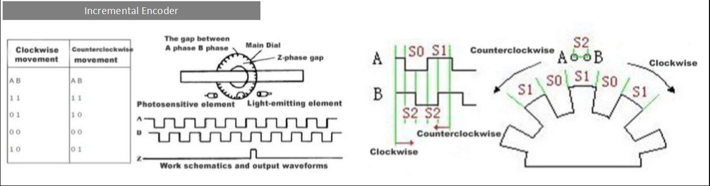

# Behavioral monitoring

## Monitoring of locomotion activity

- Using a rotary encoder 

<p align="center">
  
</p>

The algorithm to compute the position is based on the case by case transitions depicted in the drawing above (left panel), see [./locomotion.py](./locomotion.py) (`compute_speed`). The two channels of the rotary encoder are recorded on the digital inputs of the NIdaq labelled `"locomotion-channel1"` and `"locomotion-channel2"`.

The conversion to cm/s uses the radius of the mouse position on the rotating disk (setting the distance travelled during one rotation), set in the [configuration files](../acquisition/configs/) of the acquisition:
```
"treadmill":{"radius-position-on-disk-cm":5}
```
(older configurations use `"rotating-disk":{"radius-position-on-disk-cm":5.5, "roto-encoder-value-per-rotation":-12563.0}`).

To calibrate the roto-encoder value per rotation (legacy configurations), run on the setup:
```
python -m physion.behavior.locomotion -T 15
```
and do manually 5 rotations of the disk during the recording time (`-T`, in s). The value per rotation is printed: write it in the configuration file.

The running speed is computed when assembling the NWB files (see the [assembling documentation](../assembling/README.md)).


## Configure cameras

### 1) Face camera

Use the FlyCap software provided by *PT-Grey Camera* to set the acquisition frequency, gain, brightness, etc... that best suits the experiment (see the [FLIR camera documentation](../hardware/FLIRcamera/README.md)).

### 2) Webcam for the rig view

Use the *Logitech Capture* app.

## Video monitoring of pupil diameter

See the [pupil tracking documentation](../pupil/README.md).

## Video monitoring of whisking

See the [face motion documentation](../facemotion/README.md).
