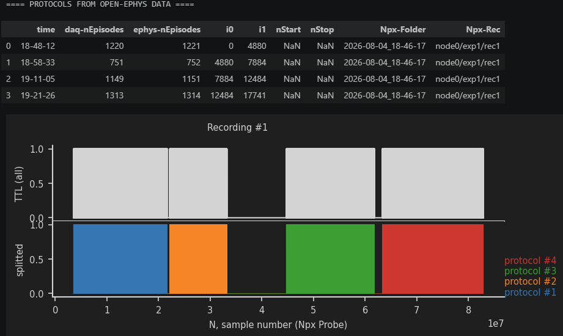
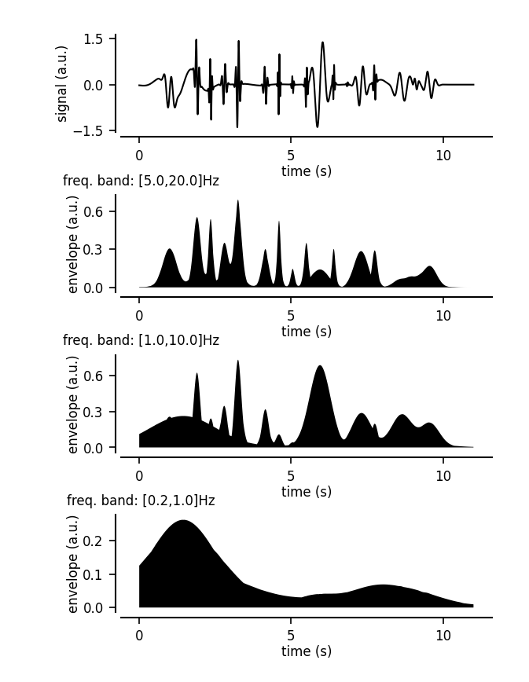

# Electrophysiology

## Overall pipeline 

__*following an experimental session recorded with OpenEphys & physion*:__

## *(0. Preprocess the facecamera data*)

1. compute and save the pupil trace (see the [pupil](../pupil/README.md) documentation)
2. compute and save the facemotion (see the [facemotion](../facemotion/README.md) documentation)
3. export to mp4 movie (in the menu `Data-Management > Convert Camera to Movies` of physion)
4. delete the raw `FaceCamera-imgs` folder

## 1. Build the DataTable for the different protocols of the session

Open the terminal (miniforge) on the `base` environment. 
For an experiment recorded in `~/DATA/2026_08_04`, you build the datatable with the command:
```
cd %USERPROFILE%/physion/src
python -m physion.assembling.dataset build-DataTable %USERPROFILE%/DATA/2026_08_04
```
this will create a file: `~\DATA\2026_08_04\DataTable0.xlsx` (rename it `DataTable.xlsx`).

N.B. You need to fill the column `Npx-Folder` (for example 2026-08-04_16-13-00) 


## 2. Run the [Ephys-Assembling.py](../../../notebooks/Ephys-Assembling.py) notebook.    

Important parameters to set up:
- `ELECTRODE_RANGE` defines the sub-selection of electrodes **kept for analysis**, default : `ELECTRODE_RANGE=[0,200]`  
        *N.B. inspect the range of electrode inserted with `python -m kilosort`*
- `PROBE_NAME`, default : `PROBE_NAME='ProbeA'`
- `EXP`  ID of the recording (starting from 1), default: `EXP=1`
- `NODE` ID of the desired Recorde Node, default : `NODE=0`
- `STREAM_NAME`, default : `STREAM_NAME='Record Node 101#OneBox-100.ProbeA'`

This will:
### a) automatically  find the probe samples aligned to NIdaq acquisition  

#### 1. **CHECK** that `daq-nEpisodes` & `ephys-nEpisodes` match (+/-1), e.g.:



#### 2. **CHECK** that synchronizing steps match for all protocols.

### b) detect bad channels and write the desired electrode range

### c) set the electrode subsampling per protocol 

default:

    - 2: for flashed stimuli (to protocol to identify layer 4)  

    - 8: for the rest  

### d) [to do...] compress and save as binary the data

## 3. Copy the Data from Acquisition to Analysis computer 

currently, this is achieved through a USB drive, e.g. if one is mounted on `D:`:
```
robocopy %USERPROFILE%/DATA/2026_08_04 D: /MIR
```

## 4. Archive the raw data on the NAS

Assuming the NAS is mounted on `Z:`:
```
robocopy %USERPROFILE%/DATA/2026_08_04 Z: /MIR
```


## 5. Run the spike sorting using spike interface (with kilosort under the hood)

### Automated preprocessing

In physion, use the menu: `Preprocessing / Spike Sorting`, select the `DataTable.xlsx` file corresponding to the experiment and launch the spike sorting. Under the hood, this launches `kilosort4` (see: https://kilosort.readthedocs.io/en/latest/README.html).  
This creates within the day folder (e.g. `2026_08_04`) a folder called `kilosort4_output`. 


You can transfer/synchronize this folder between the acquisition/spike-sorting server and an analysis computer with, e.g. (bash):
```
server_address=user@10.0.0.1
server_root_path=/media/user/DATA2
desktop_root_path=$HOME/DATA

get_spike_sorting ()
{
    day=$1
    rsync -avhP --exclude 'continuous.dat' $server_address:$server_root_path/$day $desktop_root_path
}

send_spike_sorting ()
{
    day=$1
    rsync -avhP $desktop_root_path/$day $server_address:$server_root_path 
}
```

and then, e.g.:
```
get_spike_sorting 2026_08_04
```

### Manual curation step

Do it in [Phy](https://github.com/cortex-lab/phy).


## 6. Assemble the data into a NWB file using the command:  

`python -m physion.assembling.nwb ~/DATA/2026_01_01/DataTable.xlsx`


See the [../assembling/add_ephys.py](../assembling/add_ephys.py) script (`add_ephys`), based on `spikeinterface` (`pip install "physion[ephys]"`). For each protocol of the `DataTable.xlsx` file, it:

1. reads the Open-Ephys data of the protocol (samples aligned to the NIdaq acquisition), restricted to the electrode range, and removes the bad channels listed in the DataTable (detected by the [Ephys-Assembling.py](../../../notebooks/Ephys-Assembling.py) notebook)
2. builds the electrode table
3. adds the spike times of the units labelled as "good" in the manual curation (`kilosort`/`phy`)
4. adds the spike templates of those units
5. computes and writes the Multi-Unit Activity (MUA, see below)
6. computes and writes the Local Field Potential (LFP, see below)

The signals are processed in chunks (10 s by default) to limit the memory usage.

## Extracting Single Units Spiking

- spike sorting with kilosort

- 

## Computing the Local Field Potential (LFP)

In `add_ephys` (`LFP_BAND`): band-pass filter in the band `[0.5, 300]` Hz, then downsampling by a factor 24 (i.e. 1250 Hz for a 30 kHz recording, `resampling_factor`), on the channels sub-sampled per protocol.

## Computing Multi-Unit Activity (MUA)

In `add_ephys` (`MUA_BAND`): band-pass filter in the band `[300, 6000]` Hz, rectification and average over groups of neighbouring channels, then downsampling as the LFP.

An alternative estimate of the high-frequency activity is the function `compute_freq_envelope` of `physion.ephys.tools`: it uses a continuous wavelet transform to extract the time-varying envelope of the signal in a frequency band.

To visualize the effect of the continuous wavelet transform acting in different frequency bands:


```
import numpy as np
from physion.utils import plot_tools as pt
from physion.ephys.tools import compute_freq_envelope

t = np.linspace(0, 11, int(5e4))
signal = np.zeros(len(t))

np.random.seed(11)
N = 20
for freq, start, amp in zip(
    list(np.random.uniform(0.5, 20, N)), list(1+np.arange(N)/N*9), list(np.random.randn(N)),
    ):
    sigma = 1./freq/2.
    signal += np.sin(2*np.pi*freq*(t-start))*\
        np.exp(-(t-start)**2/2./sigma**2)*amp

fig, ax = pt.figure(axes=(1,4), ax_scale=(2,1.5))
ax[0].plot(t, signal)
pt.set_plot(ax[0], xlabel='time (s)', ylabel='signal (a.u.)')
for i, band in enumerate([[5,20], [1,10], [0.2,1]]):
    mua = compute_freq_envelope(signal, 1./(t[1]-t[0]),
                    np.linspace(band[0], band[1], 5))
    ax[i+1].fill_between(t, 0*t, mua)
    pt.set_plot(ax[i+1], xlabel='time (s)', ylabel='envelope (a.u.)',
                    title='freq. band: [%.1f,%.1f]Hz' % tuple(band) +\
                        40*'  ')
fig.savefig('docs/ephys/wavelet-envelope.png')
```

