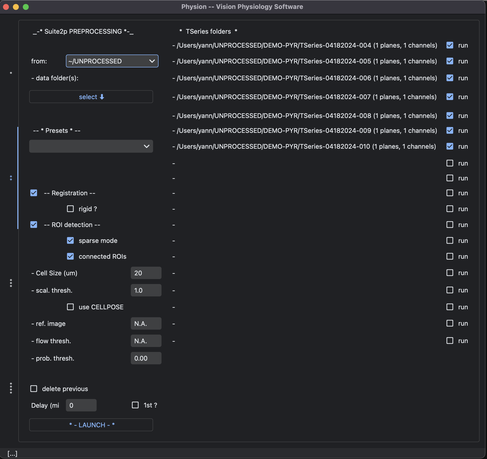

# Calcium imaging

## Block ripping from `.RAW` Bruker files 

- use the image block ripping utility from Bruker to convert the raw data to tiff files. Download the program from your Prairie version, see [https://pvupdate.blogspot.com/](https://pvupdate.blogspot.com/) (e.g. Prairie 5.5 at the [following link](https://www.brukersupport.com/File/?id=61188&folderid=44665)).

The command line arguments of the executable are the following:
```
Image-Block-Ripping.exe -KeepRaw -DoNotRipToInputDirectory -IncludeSubFolders -AddRawFileWithSubFolders $datafolder -Convert
```

To use on linux:

- get the `Image-Block-Ripping.exe` and the `daq_int.dll` files from the Bruker install
- install `wine` (>=0.9, e.g. the latest `winehq`, see [the winehq install instructions](https://gitlab.winehq.org/wine/wine/-/wikis/Download))
- install Visual C++ components (either get the dlls directly, or install them through `winetricks`: `sudo apt-get install winetricks`, then `winetricks vcrun2015`).

Then you can use the following code to automatize block-ripping:

```
datafolder=$HOME'/UNPROCESSED/'
# go to the folder where you have the executable (renamed `Run.exe`) and the `daq_int.dll` file:
cd $HOME/Block-Ripping-tools/Prairie-5.5
echo " -------------------------------- "
echo "    --> starting block ripping "
# run the Image-Block-Ripping-Utility from Prairie through wine:
exec wine "Run.exe" "-KeepRaw" "-IncludeSubFolders" "-AddRawFileWithSubFolders" "$datafolder" "-Convert"
# if you need to run wine with sudo: echo "<password>" | exec sudo -S wine "Run.exe" "-IncludeSubFolders" "-AddRawFileWithSubFolders" "$datafolder" "-Convert"  &
# monitor advancement by tracking the disappearance of *RAW* files
while :
do
	check=$(find $datafolder/* -name "*RAW*" -print)
	echo $check
	if [ "$check" = "" ]
	then
		break
	fi
	echo "  still block-ripping [...] "
	sleep 10s
done
echo " -------------------------------- "
echo "    --> Block Ripping done ! "
# --> do something else, e.g. suite2p pre-processing
```

## Raw data transfer and conversion to tiff files

- use `rsync` to transfer the raw data via `ssh`

## Registration and Cell detection with [Suite2P](https://github.com/MouseLand/suite2p)

The pipeline relies on [Suite2P](https://github.com/MouseLand/suite2p). Read the documentation at [http://mouseland.github.io/suite2p](http://mouseland.github.io/suite2p).

A minimal interface allow to launch the [Suite2P](https://github.com/MouseLand/suite2p) in the background with presets:

<p align="center">
  
</p>

Those settings are set by modifying the default options of suite2p using:
1) the properties of the acquisition metadata (extracted from the Bruker `xml` file with [xml_parser.py file](./bruker/xml_parser.py)) 
2) a set of presets defined in the [suite2p/presets.py file](./suite2p/presets.py) where we modify the suite2p options with a dictionary of the form:
    ```
    presets = {
        "cellpose-Interneurons":{
            "registration":{"nimg_init": 2000, "maxregshift": 0.15,
                            "nonrigid":False, "batch_size":200},
            "detection":{"algorithm": "cellpose", "denoise":False,
                         "cellpose_settings":{"connected":True},
                         "threshold_scaling":1.0}
        },
        ...
    }
    ```
    Each entry is a preset setting appearing in the GUI (current presets: `sourcery-thy1-Taddy`, `cellpose-Interneurons`, `hsyn-pyramidal`, `hsyn-Ventricle-inj`, `SomasOnly-zoomed`, `Interneurons`, `hsyn-Cibele`, `Test Pyramidal 3`).

N.B. we extract the available information from the `xml` Bruker file (see [bruker/xml_parser.py](./bruker/xml_parser.py)).

## Testing preprocessing settings

To run/test a given preprocessing setting (e.g. `Interneurons` here) in a `TSeries-folder`, run:
```
python -m physion.imaging.suite2p.preprocessing -cf path-to/TSeries-folder -sk Interneurons # --remove_previous
```

You can view the available settings and script options with:
```
python -m physion.imaging.suite2p.preprocessing --help
```


## Notes on `suite2p`

- pay attention to `batch_size` for the registration process, it can easily saturate the memory of our computers
- doing simultaneous registration saturates the memory, delay them by some time...
- [15/01/2023] rigid-registration has a bug, only non-rigid works

## Preprocessing and analysis

The fluorescence variations "dF/F0" were computed as follows. "dF" was the raw fluorescence corrected by the neuropil. "F0" was the sliding raw fluorescence (not corrected by the neuropil): this setting prevents the few ROIs with weak intrinsic signals and high neuropil signal from getting a F0 close to 0, and thus potentially high "dF/F0" values. This setting leads to relatively low values for the "dF/F0" variations (compared to the setting where "F0" also has the neuropil subtraction).

The preprocessing step and some analysis are illustrated in the [demo notebooks](../../../notebooks) (e.g. [Calcium-Signal-Preprocessing.py](../../../notebooks/Calcium-Signal-Preprocessing.py)).
