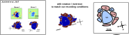

# Intrinsic Imaging

## Data acquisition and stimulation

- Strategy of [Kalatsky and Stryker, Neuron (2003)](https://doi.org/10.1016/s0896-6273(03)00286-1): using periodic stimulation (repetitions) and Fourier analysis to catch weak evoked responses.
- A flickering moving bar (N.B. straight on the screen, unlike Juavinett et al., 2016 or Zhuang et al., 2017)
- The protocol keeps on adding data. Stop whenever you are happy with the obtained maps.

## Retinotopic maps

Building retinotopic maps using the strategy of Kalatsky and Stryker (2003). From a recording `movie` that contains `Nrepeat` repetitions of the flickering bar in one direction:

```
spectrum = np.fft.fft(movie, axis=0)

# generate power map
power_map = np.abs(spectrum)[Nrepeat,:,:]

#generate phase movie
phase_map = -np.angle(spectrum)[Nrepeat,:,:] % (2.*np.pi)
```

## Segmentation of Visual Areas

The code comes from from [a script from Jun Zhuang](https://github.com/zhuangjun1981/NeuroAnalysisTools/blob/master/NeuroAnalysisTools/RetinotopicMapping.py).

## Predicted Output

<p align="center">
  
</p>


## Material and Methods

[...]

## Usage

1. Build the movies of the flickering bars for your screen (once), from the `src` folder of physion:
    ```
    python -m physion.intrinsic.build_protocols intrinsic Dell-2020
    ```
    (the second argument is a screen of [visual_stim/screens.py](../visual_stim/screens.py)). The movies are written in `physion/acquisition/protocols/movies/intrinsic/` (for the ocular dominance protocol, replace `intrinsic` by `ocular-dominance`).
2. With a MicroManager camera: start MicroManager and set up the stream to `pycromanager` in MicroManager.
3. Start physion in the intrinsic imaging mode, giving the camera interface:
    ```
    python -m physion intrinsic MicroManager
    ```
    or `python -m physion intrinsic ThorCam` for Thorlabs cameras (without camera interface, the program runs in demo mode).

## Installation steps

### 1) Install the Camera drivers from the manufacturer

Either from:
- QCam
- Thorlabs
- FLIR
- ...

### 2) Install Micromanager

Download micromanager from https://micro-manager.org/ and install it.

### 3) Set up the camera using the `Hardware Configuration Wizard` of Micromanager

In the GUI, menu: `Devices` > `Hardware Configuration Wizard`

### N.B. For Thorlab cameras (06/2023)

- Follow those steps: https://micro-manager.org/TSI
- *with* Micromanager 2.0.1 (get it from the nightly builds https://download.micro-manager.org/nightly/2.0/Windows/ )
- *with* Thorcam >=3.7


