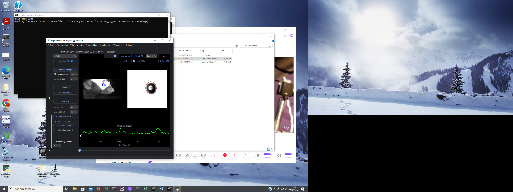

# Pupil Tracking

## Recording

[...]

## Analysis

  

1. Open the tool with the menu `Preprocessing > Pupil` of physion, then open the data folder (key [O]).
2. Click `last GUI settings`: this loads the settings that were used last, then adjust the blue circle (region of interest) on the pupil.
3. Use `reset` (to reset your modifications), `add blanks` (to add white points on dark regions that are not the pupil), `add reflect.` (to mask the reflections of light inside the pupil) and `fit Pupil [F]` (or the key F) to adjust the red circle on the pupil.
4. Check the fit along the whole video: the pupil changes over time, correct the settings where the fit fails.
5. With `subsampling ?` checked, click `process data [P]` to preview the result.
6. If the parameters are fine, uncheck `subsampling ?` and click `process data [P]`.
7. When the processing is done (it can take some time), click `save data`.
