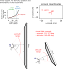
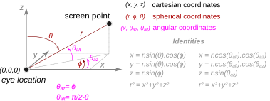
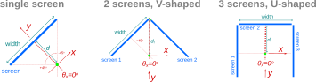
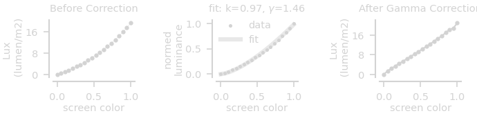

# Visual stimulation

## Overview 

This module handles the presentation of visual stimuli on a given screen. Vision neuroscience expresses [visual stimuli in angular dimensions](#mouse-visual-field-and-screen-position) and mouse vision is investigated under specific luminosity conditions. Those two aspects require some [calibration steps (see below)](#screen-calibration) for each screen setup.

To use the visual stimulation feature, be sure to follow the installation steps and screen settings described in the [installation instructions for an acquisition setup](../../../docs/install/acquisition.md)

_**Implementation**_. The custom `visual_stim` object at the basis of the visual stimulation implementation lies is defined in [main.py](./main.py). Its children objects with stimulus-specific features are found in the [stimuli/](./stimuli) folder.

_**Under the hood**_. Protocols are pre-rendered as lossless movies ([build.py](./build.py), [movie.py](./movie.py)). They are displayed by a dedicated process that draws each frame with OpenGL (`pyglet`), synchronized on the screen refresh, and logs every displayed frame ([presenter.py](./presenter.py), controlled through [show.py](./show.py)). See [Presentation](#3-presentation-timing-and-logging) below.

## Usage

### 1. Prepare a Visual Stimulation Protocol

A given protocol is described by a `json` file.   
It can be a single stimulus type or a "multiprotocol" (see below).

The different stimuli are described in [stimuli/README.md](./stimuli/README.md)


#### 1.a) Single Stimulus Protocol (with parameters variations)

The syntax for a single stimulus with parameter variations is the following:

```
{
    "Presentation": "Stimuli-Sequence",
    "Stimulus": "grating",
    "Screen": "Dell-4220",
    "-------------------------------------------- 1": 0,
    "presentation-duration": 1,
    "presentation-prestim-period": 4,
    "presentation-poststim-period": 4,
    "presentation-interstim-period": 2,
    "presentation-blank-screen-color": 0.5,
    "N-repeat": 10,
    "-------------------------------------------- 2": 0,
    "x-center-1": -40.0, "x-center-2": 40.0, "N-x-center": 5,
    "y-center-1": -20.0, "y-center-2": 20.0, "N-y-center": 4,
    "angle-1": 0.0, "angle-2": 135.0, "N-angle":4,
    "-------------------------------------------- 3": 0,
    "spatial-freq": 0.06,
    "speed": 0, 
    "radius": 10
}
```

[ [!!] ]() N.B. make sure that your screen is correctly described in the [screens.py](./screens.py) script.


now with optotgenetic stimulation:

```
{
    "Presentation": "Stimuli-Sequence",
    "Stimulus": "grating",
    "Screen": "Dell-2020",
    "shuffling": "full-with-alternate-even-odd-repeats",
    "shuffling-seed": 34,
    "presentation-duration": 2.0,
    "presentation-interstim-period": 6.0,
    "presentation-interstim-jitter": 3.0,
    "presentation-prestim-period": 6,
    "presentation-poststim-period": 6,
    "presentation-blank-screen-color": 0.5,
    "movie_refresh_freq": 30.0,
    "units": "cm",
    "-----------------------------------------------------------------0": 0,
    "-------                 --> we photostimulate on odd trials ! ----": 0,
    "-----------------------------------------------------------------1": 0,
    "Opto-stim":{
        "pre_window":1.0,
        "post_window":1.0,
        "Protocol-1":{
            "trials":"odd"
        }
    },
    "-----------------------------------------------------------------2": 0,
    "angle-1": 0.0,
    "angle-2": 90.0,
    "N-angle": 2,
    "contrast-1": 0.5,
    "contrast-2": 1.0,
    "N-contrast": 2,
    "-----------------------------------------------------------------3": 0,
    "spatial-freq": 0.04,
    "speed": 0,
    "phase": 90,
    "radius": 200,
    "-----------------------------------------------------------------4": 0,
    "N-repeat": 2
}
```

#### 1.b) Protocols made of Multiple Stimulus Types

Multiprotocols can be build as a list of single protocols with the following syntax:

```
{
  "Presentation": "multiprotocol"
  "shuffling" :"full",
  "shuffling-seed" :23,
  "Protocol-1": "subprotocols/NDNF/moving-dots.json",
  "Protocol-2": "subprotocols/NDNF/random-dots.json",
  "Protocol-3": "subprotocols/NDNF/static-patch.json",
  "presentation-blank-screen-color": 0.5,
  "presentation-prestim-period": 3,
  "presentation-poststim-period": 3,
  "presentation-interstim-period": 3,
  "Screen": "Dell-2020",
  "movie_refresh_freq":30,
}
```

## 2. Build the Protocol Video

A protocol need to be converted to a set binary movies befire being displayed.
This is achieved via the following command:

```
python -m physion.visual_stim.build ~/Desktop/protocol-folder/drifting-gratings.json
```
This generates, on all platforms:
- `movie.mkv` (or `movie-1.mkv`, `movie-2.mkv`, ... for multi-screen setups): lossless greyscale H.264, the decoded frames are bit-exact copies of the rendered ones (repeated frames, e.g. static images or blank periods, cost almost nothing).
- `movie-frames.npy`: the frame table (episode of each frame, identical consecutive frames, state of the monitoring square).

Choose `movie_refresh_freq` as a divisor of the screen refresh rate (e.g. 30 or 60 for a 60 Hz screen), otherwise the frame durations cannot be regular.

Legacy movies (`movie.mp4`/`movie.wmv`) are still played, but without the frame table; rebuild them.

You can check a protocol folder with:
```
python -m physion.visual_stim.show ~/visualStim-protocols/Yann/drifting-gratings
```

To be used in the acquisition UI the protocol folder needs to be moved (the full folder, i.e. video+metadata) at the location `physion/acquisition/protocols/movies`.


[ [!!] ]() don't forget to move the video after building it !

## 3. Presentation: timing and logging

The movie is played by a separate process ([presenter.py](./presenter.py)) that only does that: the acquisition GUI (camera previews, printing, network messages, ...) cannot delay the display anymore.

- The frames are decoded ahead in background threads (a few seconds of buffer) and drawn at each refresh, the buffer swap being synchronized on the vertical blank (vsync).
- The movie is locked on the acquisition clock: frame `k` is meant to be displayed at `t0+k/fps` (`t0`: NIdaq start). A regular cadence is used (e.g. 2 refreshes per frame for a 30 fps movie on a 60 Hz screen), and its drift with respect to the clock (refresh rates are never exactly nominal) is corrected one refresh at a time, **only between identical frames** (blank periods, static images), so the corrections are invisible. A correction during a changing stimulus is only forced if the drift exceeds one movie frame (and flagged in the log).
- After a missed refresh (computer freeze), the presentation resumes at the frame given by the clock (the frames of the freeze are skipped and logged).

Each recording contains `visual-stim-frames.npy`, the log of every buffer swap: flip time (from the NIdaq start), frame displayed, refreshes since the previous flip (>1: missed vsync), drift, flags (missed vsync, decoder underrun, corrections). A summary is printed at the end of the recording. The log is stored in the NWB files (`Visual-Stim-Frames`, `Visual-Stim-Flags` and `Visual-Stim-Square` in the stimulus section).

To check a recording, including the comparison of the recorded photodiode with the photodiode signal predicted by the log:
```
python -m physion.visual_stim.check_presentation path/to/datafolder --plot
```
It reports the display latency, and the monitoring square transitions that are missing or mistimed in the photodiode signal (e.g. frames dropped by the graphics driver after the swap, which the presentation process cannot see).

_**Screens**_. All the stimulation screens are covered by ONE borderless window (spanning them on multi-screen setups), each screen's movie drawn in its own area: one buffer swap updates all screens at the same refresh. The screens of the computer and the ones used are printed at start (`[visual stim.] ...`). The stimulation screens are found from the rig name ([show.py](./show.py), `window_settings`); for a new rig, add its desktop layout there, or set `"display-indices"` in the screen description ([screens.py](./screens.py)). Make sure that the vertical synchronization is not disabled in the graphics driver settings (a warning is printed if no vsync is detected).


## Mouse visual field and screen position

The setup corresponds to the following setting:

<p align="center">
  
</p>

The calculation using the spherical coordinates of angular view:
<p align="center">
  
</p>

The transformation into screen positions is available on the [VisualStim-design notebook](../../../notebooks/Visual-Stim-Design.py-Stim-Design.py).

Note that the conventions for the different screen setups are the following:
<p align="center">
  
</p>

## Screen calibration

### 1. Luminosity setting (brightness & contrast)

The overall idea is to maximize the contrast on the screen while adjusting the brightness to get to the desired luminosity value.

The desired value of illumination on the mouse eye position is:

- 20-25 lux (i.e. lumens/m2) for the white screen

To reach this, use a light-meter and monitor illumination while presenting a white screen on the stimulation display.

To build a simple protocol that shows a full-screen at the three screen colors black=0, grey=0.5 and white=1, you can use the protocol:
```
{
    "Presentation": "Stimuli-Sequence",
    "Stimulus": "uniform-bg",
    "Screen": "Dell-2020",
    "----------------------------------------1": 0,
    "presentation-duration": 5,
    "presentation-prestim-period": 1,
    "presentation-poststim-period": 1,
    "presentation-interstim-period": 1,
    "N-repeat": 1,
    "----------------------------------------2": 0,
    "screen-color-1": 0.0,
    "screen-color-2": 1.0,
    "N-screen-color": 3,
}
```

### 2. Gamma correction

We present a uniform full-screen at different levels of luminance, we use a photometer to measure the true light intensity in the center of the screen.

We fit the formula `f(x) = y = k * x^g ` (constrained minimization, see [gamma-correction.py](./gamma-correction.py) and fits below).
We inverse the above formula (`fi(y) = x = (y/k)^(1/g)`), and we scale the luminosity in `Psychopy` accordingly (inserting the measured `k' and 'g' parameters, here we took: `k=1.03` and `gamma=1.77`).

The gamma correction parameters have to be inserted in the [./screens.py](screens.py) script.

We show below the measurements before and after the correction

<p align="center">
  
</p>

## Making Stimulus Schematic for Figures

A [svg file: visual-stimuli.svg](../../../docs/visual_stim/visual-stimuli.svg) provides a basis to draw stimuli schematics in Inkscape.

## Tracking stimulus presentation with a photodiode

The onset timing of the stimulus presentation is very hard to precisely control from the computer. So, to have the ability to realign stimulus presentation to the physiological recordings (see the [Assembling module](../assembling/README.md), we monitor the presentation of the stimuli on the screen with a photodiode.
We add a blinking square on the left-bottom corner of the screen).
Realign physiological recordings thanks to a photodiode signal


